<!-- Header -->

  

  

  
  
  

---

###  About Me

- 📱 **Flutter Engineer** with 5+ years of experience — freelancing since 2019, full-time since 2021
- 🧱 Own apps **end-to-end**: architecture, state, networking, localization, testing and store releases
- 🏗️ Built production apps in **facilities management & IoT**, **e-commerce**, and **booking systems**
- 🏛️ Design **scalable system architectures**: modular, maintainable and production-ready
- ⚡ I make apps faster with **performance profiling** and **memory optimization**
- 🧠 Speed up development with **AI-assisted tooling**: Claude Code, MCP servers and custom agents

---

### 📊 Impact in Numbers

### 🏛️ How I Build

### 🔄 How I Ship

---

### 🛠️ Tech Stack

  
  
  
  
  
  
  
  
  
  
  
  
  

    
  
  
  
  
  
  
  
  
  

---

### 📊 GitHub Stats

  
  

  

  <picture>
    <source media="(prefers-color-scheme: dark)" srcset="https://raw.githubusercontent.com/Mosad11/Mosad11/output/snake-dark.svg" />
    
  </picture>

---

### 🚀 Featured Projects

  
  

  
  

---

<!-- Footer -->

  

